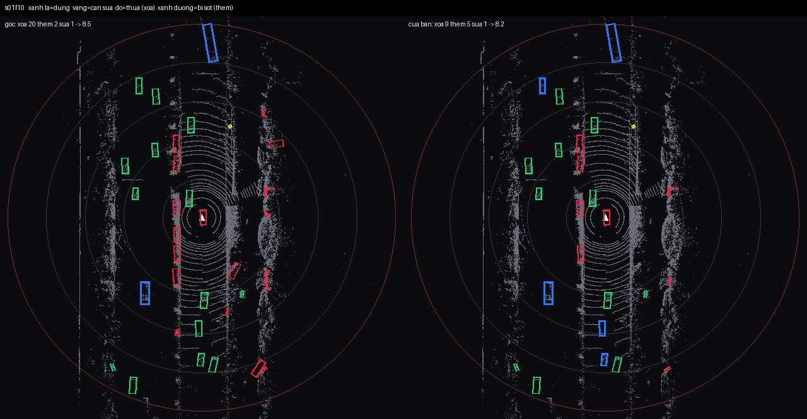

# Báo cáo Day 14 — Nguyen Xuan Khanh — 2A202603075

- Mã học viên dùng với `--student`: `075`
- `seed_tag` trong `frames_A.txt`: `393590736f`

## 1. Dự đoán trước sweep (bước 5b)

Ghi **trước** khi chạy `scripts/pp_sweep.py`, rồi commit và push ngay (lịch sử commit là bằng chứng thời điểm viết). Không sửa phần này sau khi có kết quả.

- Tham số tôi nghĩ giảm công sửa nhiều nhất: `score_thr`= 0,4 ( mức ban đầu 0,1) ,`min_points` = 5,
- Vì sao (nhìn ảnh BEV tập A: box thừa nhiều hay box sót nhiều?): baseline có 48 box cần xóa , 3 box cần thêm và 2 box cần sửa. Model dự đoán 81 box trong đó có 36 vật thể thật,  lỗi chủ yếu là box thừa với độ tin cậy thấp. Vì vậy tăng ngưỡng điểm sẽ loại phần lớn box thừa. Rủi ro: box thật độ tin cậy thấp (Pedestrian, vật thể xa) có thể bị rơi, mà mỗi box sót phạt 1.0 so với 0.3 cho mỗi box thừa.

## 2. Tập A: sửa tay và tune

| Cấu hình                                             | Xóa | Thêm | Sửa | Chi phí |
|------------------------------------------------------|----:|-----:|----:|--------:|
| Gốc (score_thr= 0.1 , min_points = 0)                |  48 |    3 |   2 |    18.4 |
| `best_config.json` (score_thr= 0.4 , min_points = 0) |  18 |    6 |   2 |    12.4 |

- Tham số đã đổi trong `best_config.json`: 
  - `score_thr`= 0,4 ( mức ban đầu 0,1) 
  - `min_points` = 0 (mức ban đầu 0)
- Kết quả leave-one-out (dán các dòng `scripts/pp_sweep.py` in ra): 
   - Leave-one-out (chọn trên các frame còn lại, chấm trên frame bỏ ra):
      - s01f10: cấu hình chọn {'score_thr': '0.4', 'min_points': '0'} → 8.2 (tốt nhất có thể 7.4)
      - s02f28: cấu hình chọn {'score_thr': '0.5', 'min_points': '0'} → 4.2 (tốt nhất có thể 1.8)
      - s04f45: cấu hình chọn {'score_thr': '0.4', 'min_points': '0'} → 2.4 (tốt nhất có thể 2.3)
- Cấu hình có ổn định trên từng frame không? Vì sao tôi vẫn chọn (hoặc không chọn) nó: 
 - Ổn định ở s04f45 (lệch oracle 0.1) và s01f10 (lệch 0.8). Không ổn định ở s02f28 (lệch 2.4): khi bỏ frame này ra, hai frame còn lại chọn mốc 0.5, quá chặt so với nó. Tổng leave-one-out là 14.8 so với baseline 18.4 , thấp hơn mức giảm  18.4 → 12.4. Chọn score_thr=0.4 vì chi phí giảm ở cả 3 frame so với gốc.

## 3. Trước/sau (bước 8)

- `scripts/pp_compare.py` :Cấu hình của bạn giảm 33% công sửa so với cấu hình gốc trên 3 frame.
- Dự đoán ở mục 1 đúng hay sai? Giải thích bằng số box xóa/thêm/sửa:
  - **Đúng: `score_thr` là tham số quan trọng nhất.** Dự đoán tăng từ 0.1 lên khoảng 0.3–0.4. Sweep chọn 0.4, chi phí giảm từ 18.4 xuống 12.4. Lập luận dựa trên số xóa (48) lớn hơn nhiều số thêm (3) cũng đúng: số xóa giảm từ 48 xuống 18.
  - **Đúng: rủi ro khi ngưỡng quá chặt.** Dự đoán mốc quá cao làm rơi box thật nên chi phí tăng lại. Ở 0.4 số box cần thêm đã tăng từ 3 lên 6. Ở 0.5 số box cần thêm lên 11 và chi phí quay lại 13.9, cao hơn 12.4.
  
Mức giảm 33% là tính trong mẫu, chọn cấu hình và chấm trên cùng 3 frame. Theo leave-one-out, ước lượng trên frame chưa thấy  14.8. Cải thiện cũng không đều: s02f28 giảm mạnh (6.0 → 1.8) , s01f10 thay đổi nhỏ (8.5 → 8.2). 
## 4. Tập B

Số đo từ `scripts/pp_prelabel.py --frames d14_<ID>/frames_B.txt --config d14_<ID>/best_config.json --gt d14_<ID>/ref_B.json`:

| Xóa | Thêm | Sửa | Chi phí |
|----:|-----:|----:|--------:|
|  90 |   22 |   7 |    52,5 |

| Frame                                                                                                                        | Xóa | Thêm | Sửa | Chi phí |
|------------------------------------------------------------------------------------------------------------------------------|---|---|---|---|
| s02f00                                                                                                                       | 4 | 1 | 1 | 2.7 |
| s02f21                                                                                                                       | 9 | 1 | 0 | 3.7 |
| s02f46                                                                                                                       | 14 | 3 | 0 | 7.2 |
| s03f00                                                                                                                       | 2 | 2 | 2 | 3.6 |
| s03f22                                                                                                                       | 5 | 5 | 0 | 6.5 |
| s03f48                                                                                                                       | 13 | 1 | 0 | 4.9 |
| s04f08                                                                                                                       | 5 | 1 | 1 | 3.0 |
| s04f26                                                                                                                       | 5 | 1 | 0 | 2.5 |
| s04f53                                                                                                                       | 2 | 2 | 0 | 2.6 |
| s05f05                                                                                                                       | 12 | 2 | 2 | 6.6 |
| s05f22                                                                                                                       | 9 | 2 | 1 | 5.2 |
| s05f48                                                                                                                       | 10 | 1 | 0 | 4.0 |
 
- Loại box tốn công sửa nhất ở tập B: s02f46     19  {'Car': 14, 'Cyclist': 4, 'Pedestrian': 1}  cảnh báo kích thước=0  1.0s | xóa 14 thêm 3 sửa 0 → chi phí 7.2

## 5. Giới hạn

- Nêu ít nhất 2 giới hạn (ví dụ: chỉ 3 frame tune; model KITTI không có Truck/Bus; chi phí là công thức, chưa phải thời gian sửa thật): 
    - Chỉ tune trên 3 frame, không biết cấu hình có ổn định trên các frame khác không.
    - Model  ít các ảnh Truck/Bus, nên dự đoán sai với các vật thể này.
    - Chi phí là công thức, chưa phải thời gian sửa thật.
    - tool dự đoán quá nhiều Cyclist dư thừa do nhiễu từ lidar với cây cối và các vật thể khác, nên chi phí tăng.
